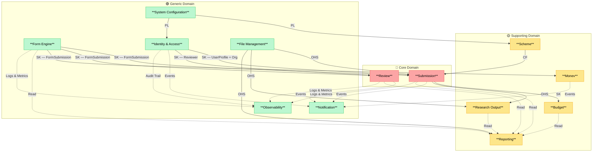
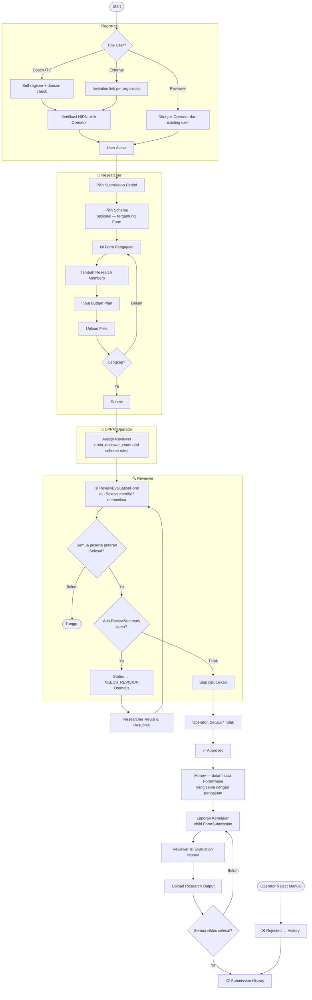
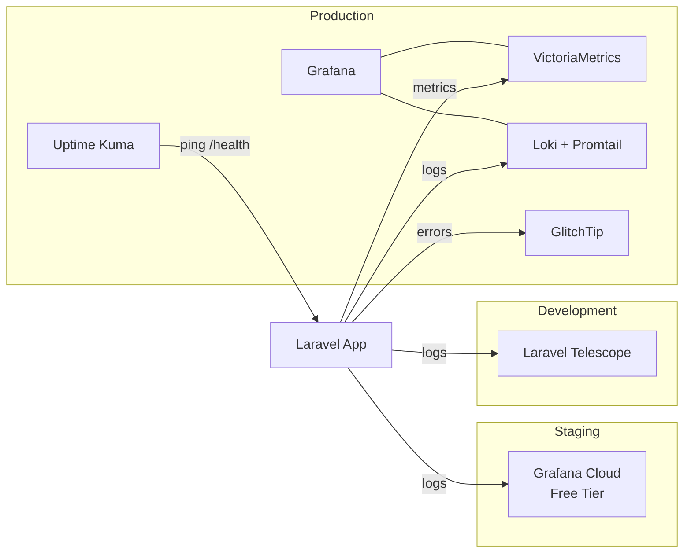

# 01 — Domain Map

**Versi:** 2.4  
**Status:** Draft

> **Perubahan v2.3 → v2.4.** Bagian *Implementation Priority* diganti dengan
> urutan milestone M0–M5.
> Lihat [ADR 0009](../../adr/0009-milestone-sequencing-critical-path-first.md).

---

## Klasifikasi Domain

| Klasifikasi       | Bounded Context      | Alasan                                                     |
| ----------------- | -------------------- | ---------------------------------------------------------- |
| 🔴 **Core**       | Submission           | Lifecycle pengajuan proposal — inti bisnis SIMPAS          |
| 🔴 **Core**       | Review               | Approval workflow yang membedakan sistem ini               |
| 🟡 **Supporting** | Budget               | Penting tapi tidak differentiating                         |
| 🟡 **Supporting** | Monev                | Penting tapi tidak differentiating                         |
| 🟡 **Supporting** | Research Output      | Pelaporan luaran penelitian                                |
| 🟡 **Supporting** | Scheme               | Katalog skema yang dikontrol admin                         |
| 🟡 **Supporting** | Reporting            | Export, statistik, audit trail, cetak dokumen              |
| 🟢 **Generic**    | Form Engine          | Platform inti dari sim-kerjasama — form, phase, submission |
| 🟢 **Generic**    | Identity & Access    | Auth, org tree, tiga jalur registrasi                      |
| 🟢 **Generic**    | Notification         | Laravel Notification                                       |
| 🟢 **Generic**    | File Management      | MinIO / Cloudflare R2                                      |
| 🟢 **Generic**    | System Configuration | Master data (tipe jurnal, tipe HKI, dll)                   |
| 🟢 **Generic**    | Observability        | Logging, metrics, error tracking, uptime                   |

---

## Bounded Context Map



---

## Main Business Flow



---

## Observability Stack per Environment



---

## Implementation Priority

Urutan di bawah menggantikan pembagian Phase 1–6 versi 2.3. Alasannya: Phase 1
dan 2 versi lama (System Configuration, Identity & Access, Form Engine, Scheme)
justru bagian yang **sudah paling jadi** di codebase, sehingga mengikutinya
berarti mengerjakan ulang yang sudah ada sambil membiarkan loop inti tetap rusak.
Notification juga tidak bisa ditaruh paling akhir karena domain event dibutuhkan
sejak Submission. Lihat
[ADR 0009](../../adr/0009-milestone-sequencing-critical-path-first.md).

```
M0 — Fondasi
├── form_phase_detail_id, scheme_id, trl_id, submission_period_id
├── Policy + isAccessibleBy()
├── Events / Listeners + Laravel Notification
├── StorageService (MinIO / R2)
└── field type scheme_selector & trl_selector, optimistic locking

M1 — Submission
├── research_members, student_members, partners, additional_files
├── SubmitFormSubmission (Temporal Field Binding, proposal PDF, deadline)
├── Budget: lock per status, max_budget, audit nilai lama/baru
└── transfer ownership, withdrawal

M2 — Review
├── EvaluateSubmissionOutcome (menggantikan auto-reject yang melanggar BR-REV-07)
├── AssignReviewers: min_reviewer_count, workload, conflict of interest
└── reassignment, visibilitas skor

    ⬇ setelah M2 sistem fungsional end-to-end

M3 — Identity & Access
└── tiga jalur registrasi, verifikasi NIDN, deaktivasi + guard ownership

M4 — Monev & Research Output
M5 — Reporting
```
