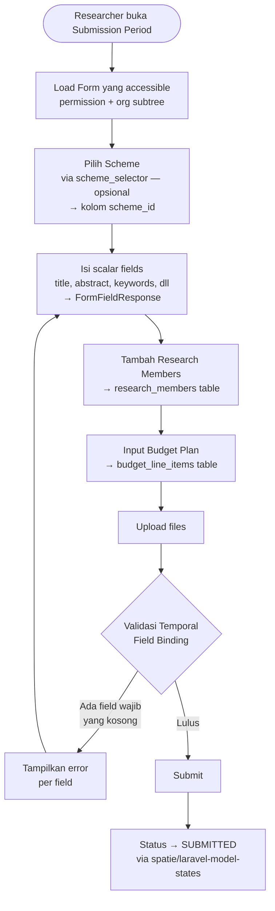
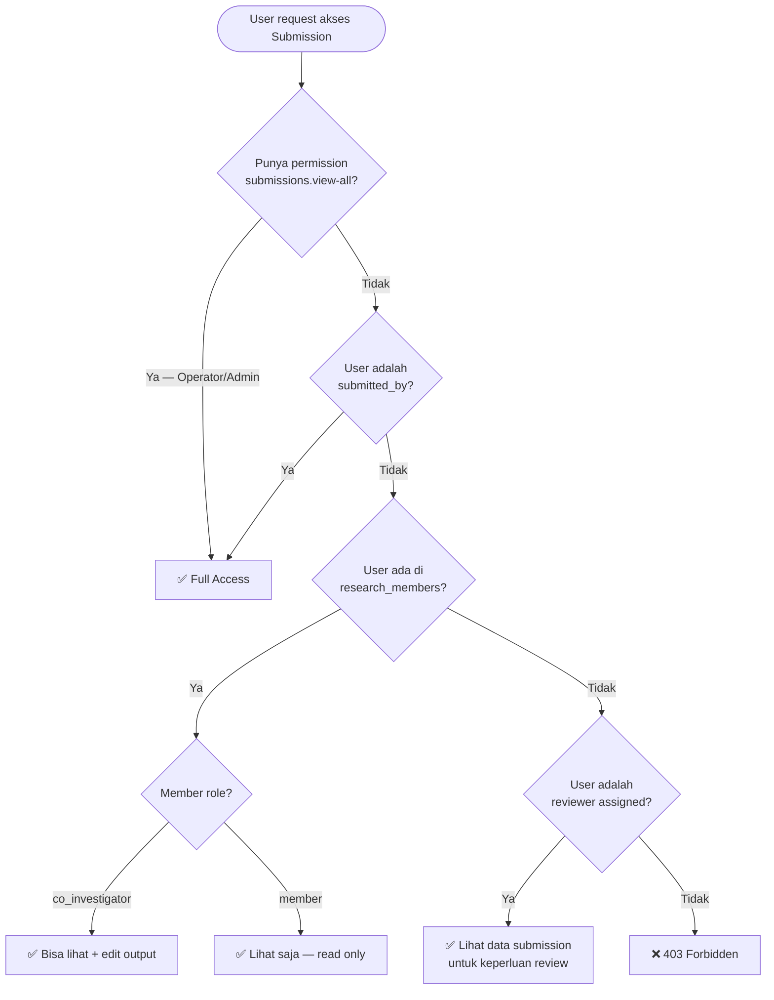
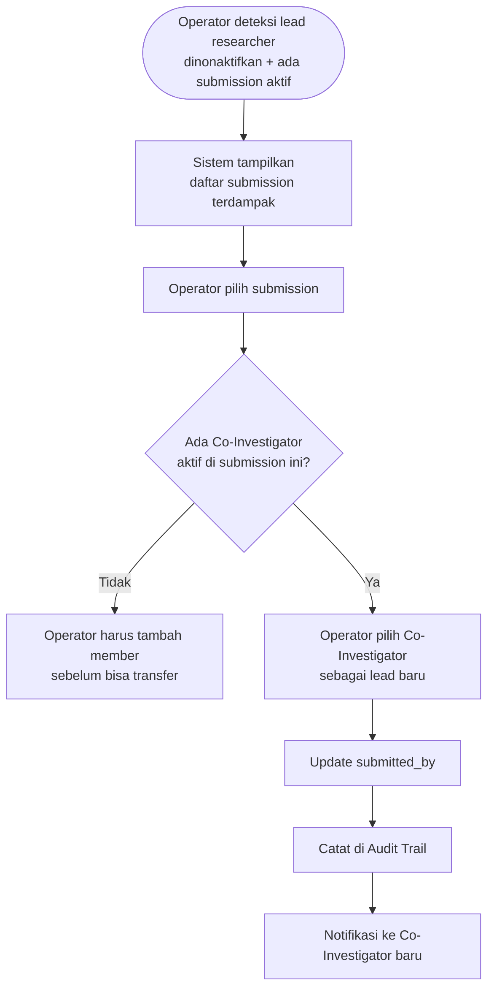
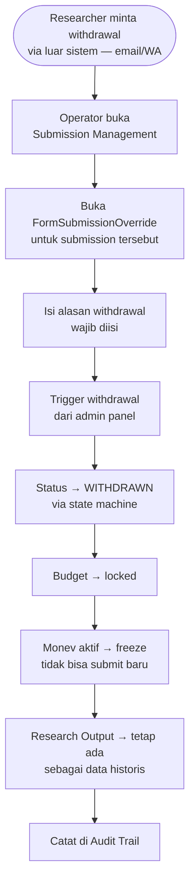
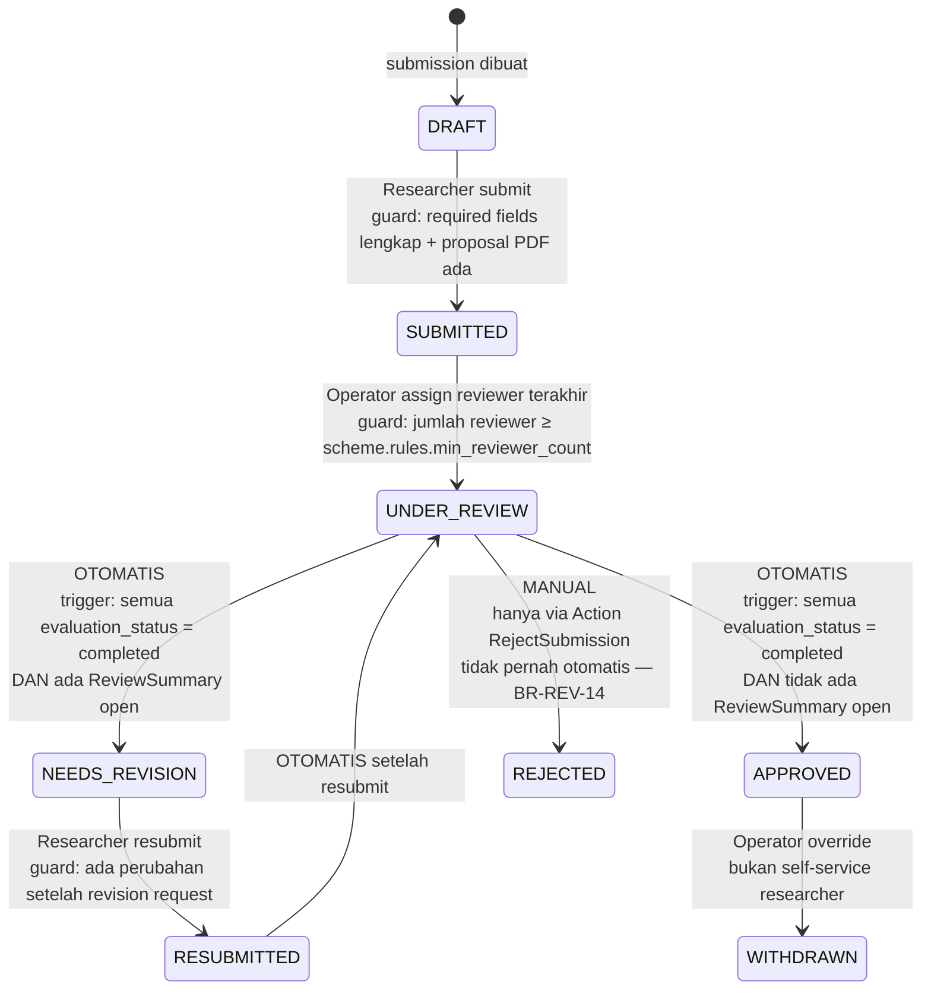
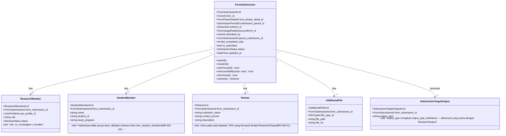

# BC: Submission

**Klasifikasi:** 🔴 Core Domain  
**Versi:** 2.4  
**Status:** Draft

> **Perubahan v2.3 → v2.4.** Alur pembuatan mengikuti **wizard tujuh langkah**
> ([ADR 0012](../../../adr/0012-wizard-driven-submission-lifecycle.md)), dan
> `form_submissions` mendapat lima kolom baru
> ([ADR 0004](../../../adr/0004-form-phase-detail-id-on-submissions.md),
> [ADR 0005](../../../adr/0005-scheme-selector-writes-to-column.md)).

---

## Responsibility

Mengelola lifecycle lengkap pengajuan proposal penelitian/pengabdian. Menggunakan `FormSubmission` dari Form Engine sebagai basis, diperluas dengan extension tables. Menyediakan dua lapis access control: form-level (via FormAccessControl) dan submission-level (via submitted_by + research_members).

---

## Activity Diagram

### Alur Pembuatan & Submit — Wizard Tujuh Langkah

Baris `form_submissions` dibuat di **langkah 1**, bukan di akhir. Ini dipaksa
BR-FE-11: Temporal Field Binding membandingkan `required_since` dengan
`submission.created_at`, jadi jangkar waktunya harus lahir saat researcher mulai
mengisi. Validasi per langkah bersifat parsial — Temporal Field Binding penuh
hanya berjalan di langkah 7.

| Langkah | Isi                   | Menulis ke                                     |
| ------- | --------------------- | ---------------------------------------------- |
| 1       | Pilih Form & Periode  | `form_submissions` (INSERT, jangkar temporal)  |
| 2       | Informasi Dasar       | `form_field_responses`                          |
| 3       | Skema, TRL & Target Luaran | `scheme_id`, `trl_id`, `submission_target_outputs` |
| 4       | Anggota Penelitian    | `research_members` (cek COI, BR-SM-08)          |
| 5       | Rencana Anggaran      | `budget_line_items` (cek `max_budget`)          |
| 6       | Upload Berkas         | `submission_additional_files`                   |
| 7       | Review & Submit       | validasi penuh → `transitionTo(Submitted)`      |

Urutan ini mengikat karena data langkah berikutnya bergantung pada skema:

- **`scheme_id` wajib sebelum langkah 5** — batas anggaran berasal dari
  `scheme.max_budget` (BR-BUD-01).
- **Target luaran berada di langkah 3, bukan langkah tersendiri** — pilihan tipenya
  dibatasi `scheme.rules.allowed_output_types` (BR-SM-14), jadi ia harus lahir setelah
  skema dipilih dan tidak bisa mendahuluinya. Jumlah langkah tetap tujuh sesuai
  [ADR 0012](../../../adr/0012-wizard-driven-submission-lifecycle.md).

**Urutan mengikat datanya, bukan navigasinya.** Researcher bebas maju-mundur antar
langkah; yang menggerbang adalah prasyarat data, bukan nomor langkah (BR-SM-17).
Memperbaiki judul di langkah 2 saat sedang di langkah 6 tidak boleh menuntut mundur
empat layar. Langkah 7 pun boleh dibuka kapan saja — yang bergerbang tombol Submit-nya.

Kedua syarat itu hanya berlaku pada Form yang punya `scheme_selector`. Skema bersifat
opsional per Form (BR-SCH-04); Form tanpa `scheme_selector` melewati pembatasan ini —
anggarannya tak berbatas dan target luarannya hanya dibatasi `output_type_definitions`.

Target luaran **tetap bisa diubah setelah wizard selesai** sampai submission REJECTED
atau WITHDRAWN (BR-SM-15), lewat tab tersendiri di halaman detail — bukan dengan membuka
ulang wizard.

### Submission-Level Access Check

### Transfer Ownership

### Withdrawal setelah APPROVED

---

## State Machine

Menggunakan **`spatie/laravel-model-states`**.

---

## Aggregates

---

## ⚠️ Feature Gap — Belum Ada di Fork

| Fitur                   | Yang Harus Dibuat                                                                             |
| ----------------------- | --------------------------------------------------------------------------------------------- |
| Research Member input   | Tabel `research_members`, UI member picker, permission visibility, conflict of interest check |
| Partner input           | Tabel `submission_partners`, UI                                                               |
| Budget Plan input       | Tabel `budget_line_items`, dynamic table UI, auto-calculate                                   |
| Scheme integration      | Tabel `schemes`, field type `scheme_selector` + `trl_selector`                                |
| `parent_submission_id`  | Kolom di `form_submissions` (untuk laporan monev + kelengkapan saja)                          |
| State machine           | Install `spatie/laravel-model-states`, implementasi per state                                 |
| Submission-level access | Method `isAccessibleBy()` di model, scope di semua controller                                 |
| Optimistic locking      | Enforce `updated_at` check di controller sebelum save                                         |

---

## Business Rules

| Kode     | Rule                                                                                                                                                                                                                                               |
| -------- | -------------------------------------------------------------------------------------------------------------------------------------------------------------------------------------------------------------------------------------------------- |
| BR-SM-01 | Researcher hanya bisa punya satu active Submission per SubmissionPeriod per Scheme. "Active" berarti **sudah disubmit** — DRAFT tidak dihitung, karena `scheme_id` masih kosong sepanjang langkah 1–2 wizard dan researcher berhak menyiapkan pengajuan ke beberapa skema sekaligus. Ditegakkan unique index parsial di database |
| BR-SM-02 | Proposal PDF wajib ada sebelum submit                                                                                                                                                                                                              |
| BR-SM-03 | Status hanya bisa berubah mengikuti state machine — tidak ada lompatan status                                                                                                                                                                      |
| BR-SM-04 | Hanya `submitted_by` yang bisa submit dan resubmit                                                                                                                                                                                                 |
| BR-SM-05 | Submission berstatus APPROVED, REJECTED, atau WITHDRAWN tidak bisa diubah kembali kecuali via operator override                                                                                                                                    |
| BR-SM-06 | **Cermin [BR-BUD-01](../supporting/01_budget.md).** Total budget tidak boleh melebihi `scheme.max_budget`. Satu validator — dipanggil dari langkah 5 wizard dan dari submit                                                                                                                                                                                              |
| BR-SM-07 | Semua query yang return submission data wajib scope via `isAccessibleBy()` — tidak cukup hanya cek FormAccessControl                                                                                                                               |
| BR-SM-08 | **Sisi anggota dari [BR-REV-02](../core/02_review.md).** ResearchMember tidak bisa ditambahkan jika user tersebut sudah jadi `SubmissionReviewer` untuk submission yang sama (mutual conflict of interest). Satu Policy, dua pemanggil                                                                                                  |
| BR-SM-09 | **Cermin [BR-IAM-10](../generic/02_identity_access.md).** Jika lead researcher dinonaktifkan dengan submission aktif, Operator wajib transfer ownership ke Co-Investigator yang aktif                                                                                                                        |
| BR-SM-10 | DRAFT tidak dihapus saat period tutup — scheduled job mengirim notifikasi ke researcher, submission menjadi archived read-only                                                                                                                     |
| BR-SM-11 | Withdrawal setelah APPROVED hanya bisa dilakukan Operator via override — tidak bisa self-service oleh Researcher. **WITHDRAWN bersifat terminal dan tidak dapat dibatalkan**: membalikkannya menuntut seluruh pembekuan hilir (kunci anggaran, freeze monev BR-MON-08, penugasan reviewer) ikut dipulihkan dengan benar, untuk peristiwa yang jarang. State machine sengaja dijaga asiklik. Kalau penarikan keliru, jalurnya pengajuan baru yang merujuk yang lama |
| BR-SM-12 | **Cermin [BR-FE-14](../generic/01_form_engine.md).** Concurrent edit dicegah via optimistic locking — `updated_at` di request harus sama dengan yang ada di DB                                                                                                                                          |
| BR-SM-13 | `isArchived()` adalah computed property — bukan status di DB. DRAFT dianggap archived jika `is_submitted = false` DAN period sudah tutup (`is_force_closed = true` ATAU semua SubmissionDate sudah terlewat). Archived submission tampil read-only |
| BR-SM-14 | Target luaran hanya boleh dari `output_type` yang terdaftar di `output_type_definitions`. Jika submission punya scheme, pilihan dibatasi lagi oleh `scheme.rules.allowed_output_types`; scheme tanpa key itu tidak membatasi apa pun |
| BR-SM-15 | Target luaran bisa diubah sampai submission REJECTED atau WITHDRAWN — termasuk setelah APPROVED, karena target menyesuaikan jalannya kegiatan. Hanya `submitted_by` yang boleh mengubahnya, dan setiap perubahan setelah APPROVED wajib tercatat di audit trail dengan nilai lama dan baru |
| BR-SM-16 | Pelanggaran BR-SM-01 dicegat **sebelum** menyentuh database: submit ditolak dengan pesan validasi yang menyebut pengajuan aktif yang sudah ada beserta tautannya. Draft yang gagal disubmit **tetap DRAFT dan tetap bisa disunting** — tidak dihapus, tidak diubah statusnya. Index unik parsial tetap ada sebagai jaring pengaman untuk lomba-balap; kalau ia yang menangkap, pesannya sama, bukan galat database mentah |
| BR-SM-17 | Navigasi wizard **bebas maju-mundur**; yang menggerbang adalah **prasyarat data per langkah**, bukan urutan. Satu-satunya prasyarat nyata: langkah anggaran butuh `scheme_id` pada Form yang punya `scheme_selector` (BR-BUD-01). Langkah Review boleh dibuka kapan saja — yang bergerbang tombol Submit-nya, bukan halamannya. Prasyarat dideklarasikan per langkah supaya tetap benar kalau urutan langkah berubah |
| BR-SM-18 | `ResearchMember` dikeluarkan oleh `submitted_by`, hanya selama pengajuan belum berstatus terminal. Ketua pengaju **tidak bisa mengeluarkan dirinya sendiri**: `submitted_by` adalah sumbu access control [BR-SM-07](#business-rules), dan pengajuan tanpa ketua tidak punya siapa pun yang berhak menyentuhnya — yang hendak melepas kepemilikan memakai jalur transfer [BR-SM-09](#business-rules). Tanpa jalur keluar, batas anggota [BR-SCH-03](../supporting/04_scheme.md) menjadi jalan buntu: kuota penuh, dan tidak ada cara menurunkannya |
| BR-SM-19 | `SubmissionTargetOutput` dihapus oleh `submitted_by` sampai pengajuan REJECTED atau WITHDRAWN — gerbang yang sama dengan penyuntingannya ([BR-SM-15](#business-rules)). Co-Investigator hanya membaca, berbeda dari [BR-RO-07](../supporting/03_research_output.md) pada luaran realisasi, dan perbedaannya disengaja: target adalah janji ketua pengaju |
| BR-SM-20 | Anggota mahasiswa dicatat sebagai **data, bukan akun**: mahasiswa tidak mendaftar ke SIMPAS, jadi `StudentMember` menyimpan nama, NIM, dan program studinya apa adanya. Jumlahnya dibatasi `scheme.rules.max_student_members`; skema yang tidak menyatakannya tidak membatasi — sejajar `allowed_output_types` di [BR-SM-14](#business-rules). Sumbu siapa dan kapannya sama dengan anggota bergelar ([BR-SM-18](#business-rules)): hanya `submitted_by`, dan hanya selama pengajuan belum terminal |
| BR-SM-21 | Mitra eksternal dicatat sebagai **baris, bukan teks**. `output_type = 'pks'` sudah menyimpan `involved_parties` di metadata JSON-nya ([BR-RO-02](../supporting/03_research_output.md)), tapi itu kemitraan yang **sudah terwujud** dan tersimpan dalam bentuk yang tidak bisa ditanyai: tidak ada cara menjawab "berapa pengajuan yang melibatkan institusi ini". `Partner` mencatat mitra **pada saat diajukan** — dua momen, dua entitas, sejajar [BR-SM-14](#business-rules) versus [BR-RO-05](../supporting/03_research_output.md) pada luaran. Sumbu siapa dan kapannya sama dengan anggota ([BR-SM-18](#business-rules)): hanya `submitted_by`, dan hanya selama pengajuan belum terminal |

---

## Domain Events

| Event                    | Trigger                                | Consumer                                  |
| ------------------------ | -------------------------------------- | ----------------------------------------- |
| `ProposalSubmitted`      | Status → SUBMITTED                     | Review, Notification                      |
| `ProposalResubmitted`    | Status → RESUBMITTED                   | Review, Notification                      |
| `ProposalApproved`       | Status → APPROVED (otomatis)           | Budget (lock), Notification               |
| `ProposalRejected`       | Status → REJECTED (operator)           | Notification                              |
| `ProposalWithdrawn`      | Status → WITHDRAWN (operator override) | Budget (lock), Notification               |
| `OwnershipTransferred`   | submitted_by berubah                   | Notification, Reporting (audit)           |
| `SubmissionPeriodOpened` | Period dibuka                          | Notification                              |
| `SubmissionPeriodClosed` | Period tutup                           | Notification (ke DRAFT yang belum submit) |

---

## Integration Map

| Context           | Arah                    | Keterangan                                         |
| ----------------- | ----------------------- | -------------------------------------------------- |
| Form Engine       | Upstream → Submission   | FormSubmission sebagai basis                       |
| Scheme            | Upstream → Submission   | Aturan max_budget, max_members, min_reviewer_count |
| Identity & Access | Upstream → Submission   | UserProfileId untuk lead + members                 |
| File Management   | Upstream → Submission   | Upload proposal + additional files                 |
| Budget            | Submission → Downstream | Extension table FK ke form_submission_id           |
| Review            | Submission → Downstream | Event ProposalSubmitted memicu review              |
| Reporting         | Submission → Read       | Reporting baca data untuk statistik dan export     |
