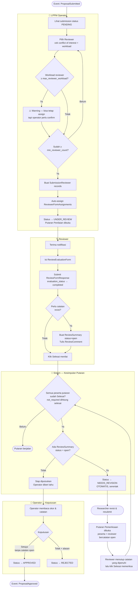
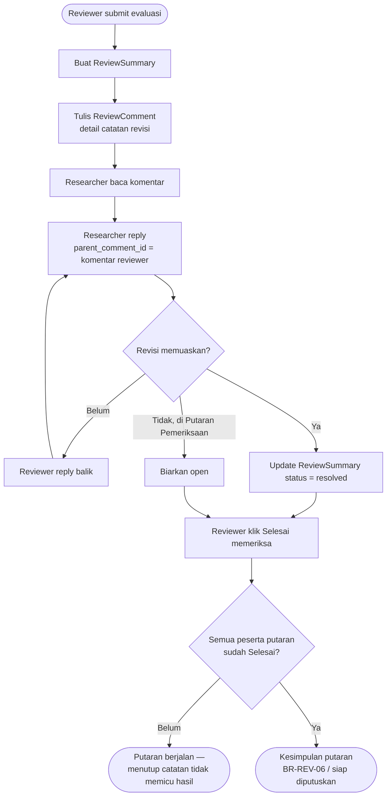
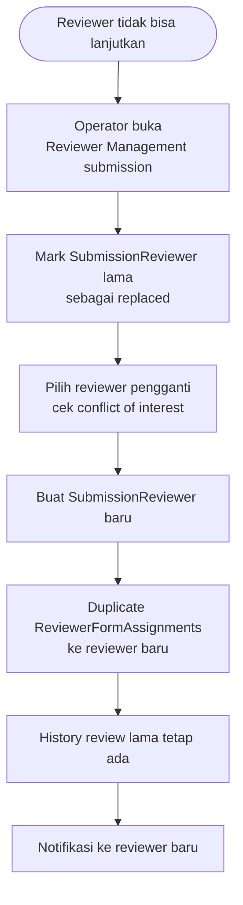
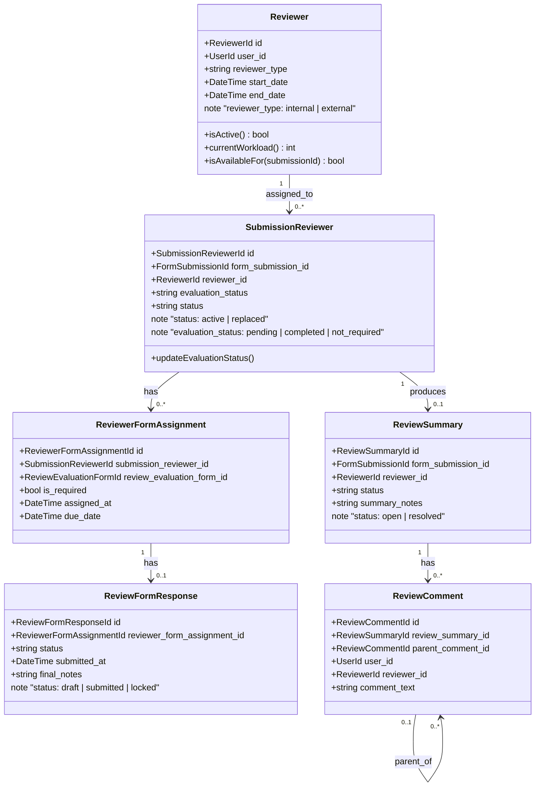

# BC: Review

**Klasifikasi:** 🔴 Core Domain  
**Versi:** 2.5  
**Status:** Draft

> **Perubahan v2.4 → v2.5.** Hasil review dihitung di **akhir putaran review**
> (BR-REV-16), dan APPROVED hanya lewat aksi **Setujui** Operator (BR-REV-05). Revisi
> tetap otomatis dari catatan reviewer (BR-REV-06), tapi baru dihitung setelah setiap
> peserta putaran menekan *Selesai*. Lihat
> [ADR 0018](../../../adr/0018-review-outcome-at-round-end-operator-approves.md).

> **Perubahan v2.3 → v2.4.** Ditegaskan bahwa **tidak ada jalur otomatis menuju
> REJECTED**. Kode warisan fork sempat men-set `Rejected` otomatis dari
> `ReviewSummary` berstatus `closed` — status yang tidak pernah ada di domain ini.
> Lihat [ADR 0006](../../../adr/0006-rejection-is-manual-only.md).

---

## Responsibility

Mengelola penugasan reviewer, evaluasi kuantitatif, diskusi revisi, dan **putaran review**. Skor dan catatan reviewer adalah masukan; **persetujuan dan penolakan adalah keputusan Operator**, diambil setelah pengajuan siap diputuskan. Revisi adalah wewenang reviewer: catatan yang masih terbuka saat putaran selesai mengembalikan pengajuan ke peneliti secara otomatis.

---

## Activity Diagram

### Alur Assignment & Evaluasi

### Alur Threaded Discussion (Revisi)

### Reviewer Reassignment

---

## Aggregates

---

## Reviewer Roles via Spatie

Tidak ada tabel `reviewer_roles`. Perbedaan dikelola via dua Spatie roles:

| Spatie Role         | Permissions                                                                   | Keterangan                                          |
| ------------------- | ----------------------------------------------------------------------------- | --------------------------------------------------- |
| `reviewer_internal` | `reviewers.evaluate`, `submissions.view-assigned`, `review.view-other-scores` | Bisa lihat skor reviewer lain setelah semua selesai |
| `reviewer_external` | `reviewers.evaluate`, `submissions.view-assigned`                             | Tidak bisa lihat skor reviewer lain                 |

Tabel `reviewers` menyimpan `reviewer_type varchar` (`internal` / `external`) untuk display dan reporting.

---

## Business Rules

| Kode      | Rule                                                                                                                                                          |
| --------- | ------------------------------------------------------------------------------------------------------------------------------------------------------------- |
| BR-REV-01 | Jumlah reviewer yang di-assign harus ≥ `scheme.rules.min_reviewer_count`                                                                                      |
| BR-REV-02 | Reviewer tidak bisa di-assign ke submission yang ia menjadi `submitted_by` atau `ResearchMember`-nya (mutual block — juga berlaku sebaliknya saat add member) Sisi anggota dinyatakan [BR-SM-08](../core/01_submission.md); pembatasan per-role dinyatakan [BR-IAM-07](../generic/02_identity_access.md). |
| BR-REV-03 | Reviewer yang sama tidak bisa di-assign dua kali ke submission yang sama dalam satu siklus                                                                    |
| BR-REV-04 | Jika workload reviewer melebihi `scheme.rules.max_reviewer_workload`, operator mendapat warning — bukan hard block                                            |
| BR-REV-05 | Submission menjadi APPROVED **hanya** lewat aksi Setujui Operator, dan hanya bila siap diputuskan (putaran review terakhir selesai, atau fase tanpa review) dan tidak ada ReviewSummary `open`. Lihat [ADR 0018](../../../adr/0018-review-outcome-at-round-end-operator-approves.md) |
| BR-REV-06 | Saat putaran review selesai dan masih ada ReviewSummary `open`, Submission masuk NEEDS_REVISION otomatis — serentak untuk semua catatan putaran itu |
| BR-REV-07 | Rejection harus dikonfirmasi manual oleh Operator — tidak bisa otomatis — dan hanya bila Submission siap diputuskan |
| BR-REV-08 | **Cermin [BR-FE-05](../generic/01_form_engine.md).** ReviewFormResponse tidak bisa diedit setelah `status = submitted`, kecuali lewat [BR-REV-19](#business-rules)                                                                                             |
| BR-REV-09 | Reviewer hanya aktif selama rentang `start_date` hingga `end_date`                                                                                            |
| BR-REV-10 | Saat reviewer diganti (reassignment), SubmissionReviewer lama di-mark `replaced` — tidak dihapus                                                              |
| BR-REV-11 | `reviewer_internal` bisa lihat skor reviewer lain setelah semua selesai — `reviewer_external` tidak bisa                                                      |
| BR-REV-12 | Researcher hanya bisa lihat skor evaluasi reviewer setelah submission berstatus APPROVED atau REJECTED — tidak selama proses review berlangsung Dikecualikan untuk siklus monev oleh [BR-MON-09](../supporting/02_monev.md). |
| BR-REV-13 | `ReviewSummary.status` hanya boleh `open` atau `resolved`. Tidak ada `closed` — status itu tidak pernah ada di domain ini                                     |
| BR-REV-14 | Tidak boleh ada jalur kode yang men-transisikan submission ke REJECTED secara otomatis. Satu-satunya jalur masuk adalah Action `RejectSubmission` yang dipanggil Operator dengan alasan wajib |
| BR-REV-15 | ReviewSummary `open` milik reviewer yang di-`replaced` **diwarisi reviewer penggantinya**, yang berhak me-resolve-nya. Penulis aslinya tetap terbaca dari record lama (BR-REV-10). Tanpa aturan ini summary itu tidak akan pernah bisa ditutup dan submission terkunci di NEEDS_REVISION selamanya — reviewer lama sudah tidak berwenang, reviewer baru tidak merasa berhak |
| BR-REV-16 | Hasil review dihitung di akhir putaran. Putaran penilaian: peserta = semua SubmissionReviewer aktif; masing-masing menekan *Selesai menilai* setelah evaluasinya `completed`. Putaran pemeriksaan (setelah resubmit): peserta = reviewer aktif yang punya ReviewSummary `open`; masing-masing menekan *Selesai memeriksa*. `not_required` dihitung selesai. Tanda Selesai per reviewer per putaran, tidak bisa dibatalkan. Mengirim lembar penilaian atau menutup catatan tidak memicu hasil. Reviewer pengganti (BR-REV-10) menjadi peserta yang belum selesai |
| BR-REV-17 | ReviewSummary untuk Submission utama hanya boleh dibuka peserta putaran berjalan yang belum menekan Selesai |
| BR-REV-18 | Versi Form Evaluasi dipaku per angkatan × langkah × Form Evaluasi saat draf penilaian pertama di sana tersimpan. Sebelumnya berlaku versi terbit terbaru; sesudahnya semua reviewer langkah itu di angkatan itu — termasuk yang ditugaskan belakangan — memakai versi pakuan. Versi yang terbit tidak berubah |
| BR-REV-19 | Operator boleh menerapkan versi terbaru Form Evaluasi ke satu angkatan × langkah. Jawaban yang ada — draf maupun sudah disubmit — menjadi riwayat yang tetap terbaca, dan reviewer-nya mengisi ulang versi baru serta diberi tahu. Pengecualian atas BR-REV-08. Ditolak bila sudah ada pengajuan di langkah itu yang diputuskan; tidak ada transisi status baru dan keputusan yang sudah diambil tidak dibatalkan. Batas Evaluasi tidak digeser: pengajuan yang tenggatnya lewat disebut sebelum dan sesudah diterapkan, dan Operator memberi perpanjangan per pengajuan ([BR-FE-27](../generic/01_form_engine.md)) |

---

## Domain Events

| Event                      | Trigger                                                | Consumer                        |
| -------------------------- | ------------------------------------------------------ | ------------------------------- |
| `ReviewerAssigned`         | Operator assign reviewer                               | Notification                    |
| `EvaluationSubmitted`      | Reviewer submit ReviewFormResponse                     | (internal — tidak memicu hasil) |
| `ReviewRoundFinishedByReviewer` | Reviewer menekan Selesai menilai / Selesai memeriksa | (internal: kesimpulan putaran) |
| `RevisionRequested`        | Putaran selesai dengan ReviewSummary open → NEEDS_REVISION | Submission, Notification   |
| `RevisionResolved`         | ReviewSummary → resolved                               | Notification (tidak memicu hasil) |
| `RecheckRequested`         | Researcher resubmit → Putaran Pemeriksaan dibuka       | Notification (peserta putaran)  |
| `SubmissionReadyForDecision` | Putaran selesai tanpa ReviewSummary open             | Notification (LPPM Operator)    |
| `ProposalApproved`         | Operator menyetujui                                    | Submission (status → APPROVED), Notification |
| `ProposalRejectedByReview` | Operator konfirmasi reject                             | Submission (status → REJECTED)  |
| `ReviewerReassigned`       | Operator ganti reviewer                                | Notification, Reporting (audit) |

---

## Integration Map

| Context           | Arah                | Keterangan                                         |
| ----------------- | ------------------- | -------------------------------------------------- |
| Form Engine       | Upstream → Review   | ReviewEvaluationForm, ReviewSummary, ReviewComment |
| Submission        | Upstream → Review   | Consume ProposalSubmitted                          |
| Identity & Access | Upstream → Review   | UserProfileId untuk conflict of interest check     |
| Submission        | Review → Downstream | Publish approved/rejected event ke Submission      |
| Reporting         | Review → Read       | Data evaluasi untuk statistik dan export           |
