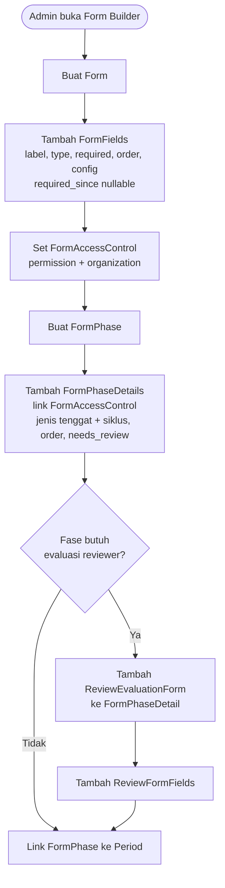
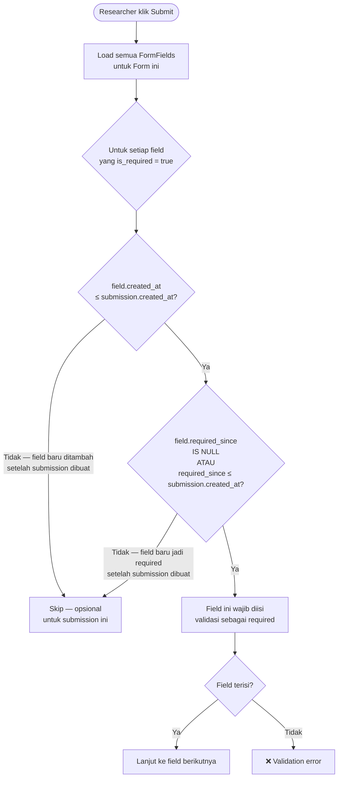
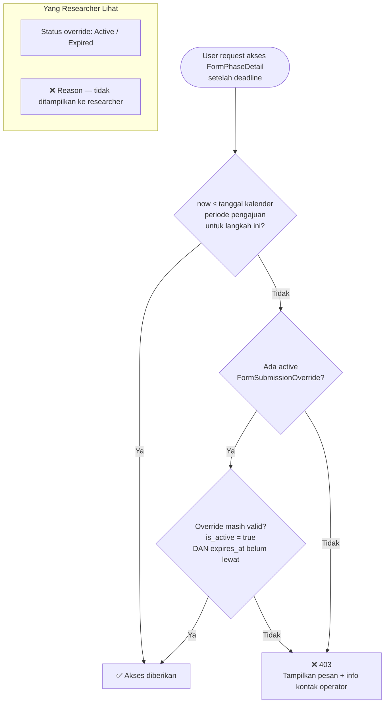
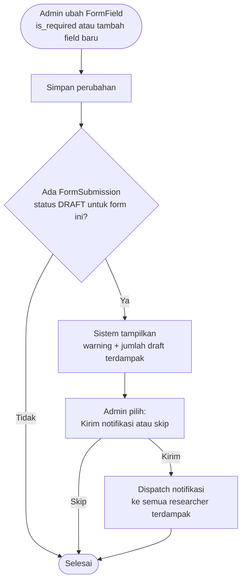

# BC: Form Engine

**Klasifikasi:** 🟢 Generic Domain  
**Versi:** 2.5  
**Status:** Draft

> **Perubahan v2.4 → v2.5** ([ADR 0019](../../../adr/0019-fase-template-jadwal-periode-form-evaluasi-berversi.md),
> pemilik 2026-11-10). **Jadwal milik periode.** `FormPhaseDetail` tidak lagi menunjuk
> `SubmissionDate`; ia menyebut **jenis tenggat** (`submit`/`output`) dan **siklus**-nya,
> dan setiap gerbang waktu membaca tanggalnya dari **kalender periode milik pengajuan**.
> Satu fase kini bisa dipakai banyak periode, masing-masing dengan tanggalnya sendiri,
> tanpa angkatan lama kehilangan tanggalnya. BR-FE-07, 17, 21, 26, 27 ditulis ulang;
> kodenya tetap.

---

## Responsibility

Platform inti yang diwarisi dari sim-kerjasama-itk. Generik dan bisa dipakai untuk sistem apapun — tidak ada business logic SIMPAS di sini. Semua BC lain dibangun di atas Form Engine.

---

## Activity Diagram

### Alur Konfigurasi Form



### Temporal Field Binding — Alur Validasi Submit



### Alur Override Deadline



### Alur Perubahan Form dengan Active Drafts



---

## Aggregates

```mermaid
classDiagram
    class Form {
        +FormId id
        +string title
        +string description
        +FormTypeId form_type_id
        +bool is_active
    }

    class FormField {
        +FormFieldId id
        +FormId form_id
        +string label
        +bool is_required
        +FieldTypeId field_type_id
        +int order
        +Json config
        +DateTime created_at
        +DateTime required_since
        +DateTime deleted_at
        +isRequiredFor(FormSubmission) bool
    }

    class FormFieldOption {
        +FormFieldOptionId id
        +FormFieldId form_field_id
        +string label
    }

    class FormAccessControl {
        +FormAccessControlId id
        +FormId form_id
        +string permission
        +OrganizationId organization_id
    }

    class FormPhase {
        +FormPhaseId id
        +string title
        +string description
        +bool is_active
    }

    class FormPhaseDetail {
        +FormPhaseDetailId id
        +FormPhaseId form_phase_id
        +FormAccessControlId form_access_control_id
        +DeadlineType deadline_type
        +int deadline_cycle
        +PhaseTypeId phase_type_id
        +int order
        +bool needs_review
        +isWithinDeadline(SubmissionPeriod, DeadlineType) bool
        +isAccessibleFor(FormSubmission) bool
    }

    class SubmissionPeriod {
        +SubmissionPeriodId id
        +string name
        +bool is_force_closed
        +deadlineFor(FormPhaseDetail, DeadlineType) SubmissionDate
    }

    class SubmissionDate {
        +SubmissionDateId id
        +SubmissionPeriodId period_id
        +DeadlineType type
        +int cycle
        +DateTime datetime
        +label() string
    }

    class FormSubmission {
        +FormSubmissionId id
        +FormId form_id
        +UserId submitted_by
        +FormSubmissionId parent_submission_id
        +bool is_submitted
        +SubmissionStatus status
        +DateTime created_at
        +DateTime updated_at
        +submit()
        +canProceed() bool
        +isAccessibleBy(User) bool
    }

    class FormFieldResponse {
        +FormFieldResponseId id
        +FormSubmissionId form_submission_id
        +FormFieldId form_field_id
        +string value
    }

    class FormSubmissionOverride {
        +FormSubmissionOverrideId id
        +FormSubmissionId form_submission_id
        +FormPhaseDetailId form_phase_detail_id
        +UserId granted_by
        +string reason
        +DateTime expires_at
        +bool is_active
        +isValid() bool
        +revoke()
    }

    class ReviewEvaluationForm {
        +ReviewEvaluationFormId id
        +FormPhaseDetailId form_phase_detail_id
        +string title
        +bool is_required
        +bool is_active
        +int order
    }

    class ReviewFormField {
        +ReviewFormFieldId id
        +ReviewEvaluationFormId review_evaluation_form_id
        +FieldTypeId field_type_id
        +string label
        +bool is_required
        +int order
        +Json validation_rules
    }

    class ReviewerFormAssignment {
        +ReviewerFormAssignmentId id
        +SubmissionReviewerId submission_reviewer_id
        +ReviewEvaluationFormId review_evaluation_form_id
        +bool is_required
        +DateTime assigned_at
        +DateTime due_date
    }

    class ReviewFormResponse {
        +ReviewFormResponseId id
        +ReviewerFormAssignmentId reviewer_form_assignment_id
        +string status
        +DateTime submitted_at
        +string final_notes
    }

    class ReviewSummary {
        +ReviewSummaryId id
        +FormSubmissionId form_submission_id
        +ReviewerId reviewer_id
        +string status
        +string summary_notes
    }

    class ReviewComment {
        +ReviewCommentId id
        +ReviewSummaryId review_summary_id
        +ReviewCommentId parent_comment_id
        +UserId user_id
        +string comment_text
    }

    class SubmissionReviewer {
        +SubmissionReviewerId id
        +FormSubmissionId form_submission_id
        +ReviewerId reviewer_id
        +string evaluation_status
        +string status
    }

    Form "1" --> "0..*" FormField : has
    Form "1" --> "0..*" FormAccessControl : controlled_by
    FormField "1" --> "0..*" FormFieldOption : has
    FormPhase "1" --> "1..*" FormPhaseDetail : has
    SubmissionPeriod "1" --> "0..*" SubmissionDate : kalender
    FormPhaseDetail ..> SubmissionDate : tanggal dibaca lewat jenis + siklus
    FormPhaseDetail "1" --> "0..*" ReviewEvaluationForm : has
    FormPhaseDetail "1" --> "0..*" FormSubmissionOverride : overridden_by
    ReviewEvaluationForm "1" --> "1..*" ReviewFormField : has
    FormSubmission "1" --> "0..*" FormFieldResponse : has
    FormSubmission "1" --> "0..*" SubmissionReviewer : has
    FormSubmission "0..1" --> "0..*" FormSubmission : parent_of
    SubmissionReviewer "1" --> "0..*" ReviewerFormAssignment : has
    ReviewerFormAssignment "1" --> "0..1" ReviewFormResponse : has
    FormSubmission "1" --> "0..*" ReviewSummary : has
    ReviewSummary "1" --> "0..*" ReviewComment : has
```



---

## Temporal Field Binding

Logika validasi field saat submit:

```php
public function isRequiredFor(FormSubmission $submission): bool
{
    // Field harus sudah ada sebelum submission dibuat
    if ($this->created_at > $submission->created_at) {
        return false;
    }

    // Field harus sudah required sebelum submission dibuat
    if ($this->required_since !== null && $this->required_since > $submission->created_at) {
        return false;
    }

    return $this->is_required;
}
```

Ketika operator mengubah `is_required` dari false ke true, sistem otomatis set `required_since = now()`. Ketika field dibuat dengan `is_required = true`, `required_since` diset sama dengan `created_at`.

---

## FormSubmissionOverride — Visibility ke Researcher

Researcher bisa melihat **status** override (aktif atau sudah expired) di UI — tampil sebagai badge "Akses Diperpanjang oleh Operator". Researcher **tidak bisa melihat** `reason` — itu hanya untuk Operator dan Admin.

---

## Optimistic Locking

Semua save operation menyertakan `updated_at` check:

```php
// Di controller sebelum save
$submission = FormSubmission::lockForUpdate()->find($id);
if ($submission->updated_at->ne($request->last_updated_at)) {
    return response()->json([
        'message' => 'Data sudah diubah oleh pengguna lain. Muat ulang halaman.'
    ], 409);
}
```

---

## Business Rules

| Kode     | Rule                                                                                                                      |
| -------- | ------------------------------------------------------------------------------------------------------------------------- |
| BR-FE-01 | FormSubmission hanya bisa dibuat selama "Batas Submit" siklus pengajuan utama (jenis `submit`, siklus kosong — [BR-FE-25](#business-rules)) periodenya belum lewat dan periodenya tidak `is_force_closed`. Tanggal lain yang masih di depan — Batas Evaluasi, Batas Revisi, batas monev — **tidak** membuka periode bagi pengajuan baru; periode tanpa Batas Submit belum bertanggal dan belum menerima pengajuan |
| BR-FE-02 | User hanya bisa akses Form jika ada FormAccessControl yang match permission user DAN organisasinya merupakan ancestor-or-self dari organisasi user (ADR 0013) |
| BR-FE-03 | FormFieldResponse hanya menyimpan scalar values                                                                           |
| BR-FE-04 | Child FormSubmission hanya bisa dibuat jika parent sudah APPROVED                                                         |
| BR-FE-05 | ReviewFormResponse tidak bisa diedit setelah `status = submitted` Dicerminkan [BR-REV-08](../core/02_review.md). |
| BR-FE-06 | Reviewer hanya bisa membuat ReviewSummary setelah `evaluation_status = completed` atau `not_required`                     |
| BR-FE-07 | Setiap `FormPhaseDetail` menyebut **jenis tenggat** — `submit` atau `output` — dan **siklus**: kosong, atau `n ≥ 1` untuk laporan Monev n. `output` (Upload Luaran) selalu tanpa siklus. Langkah tidak menunjuk tanggal; tanggalnya dibaca dari kalender periode pengajuan ([BR-FE-26](#business-rules)). Pasangan ini sekaligus menandai jenis langkah: `submit` tanpa siklus = pengajuan, `submit` siklus n = laporan Monev n, `output` = Upload Luaran |
| BR-FE-08 | Akses ke FormPhaseDetail di-hard-block jika deadline lewat dan tidak ada active FormSubmissionOverride Diterapkan ke fase monev oleh [BR-MON-05](../supporting/02_monev.md). |
| BR-FE-09 | FormSubmissionOverride.reason wajib diisi — tidak boleh kosong                                                            |
| BR-FE-10 | Override hanya berlaku untuk satu form_submission_id + satu form_phase_detail_id                                          |
| BR-FE-11 | Field hanya di-enforce is_required jika `created_at ≤ submission.created_at` DAN `required_since ≤ submission.created_at` |
| BR-FE-12 | FormField menggunakan soft delete (`deleted_at`) — tidak boleh hard delete                                                |
| BR-FE-13 | Saat operator **menerbitkan** perubahan Form yang punya active drafts ([BR-FE-34](#business-rules)), sistem prompt untuk kirim notifikasi ke researcher terdampak |
| BR-FE-14 | Concurrent edit dicegah via optimistic locking — `updated_at` di request harus match dengan yang di DB Dicerminkan [BR-SM-12](../core/01_submission.md). |
| BR-FE-15 | Expired FormPhaseDetail tetap tampil di UI sebagai read-only — user bisa lihat apa yang sudah disubmit                    |
| BR-FE-16 | Researcher bisa melihat *status* FormSubmissionOverride (aktif/expired), tapi tidak boleh melihat `reason` — reason hanya untuk Operator dan Admin |
| BR-FE-17 | Jendela kerja aktor dibaca dari **kalender periode pengajuan** untuk langkah yang sedang dikerjakan, dan mengikat **aktor langkah itu sendiri**, bukan seluruh alur. Setiap tahap yang berjalan setelah submit — evaluasi reviewer, revisi — punya jenis tenggatnya sendiri di kalender (Batas Evaluasi, Batas Revisi) pada siklus langkah itu. Memakai ulang "Batas Submit" untuk tahap-tahap itu membuat jendela kerjanya nol atau negatif |
| BR-FE-18 | `required_since` disetel **saat aturannya berubah**, bukan mundur: field yang dibuat `is_required = true` mendapat `required_since = created_at`, dan field yang diubah dari false ke true mendapat `required_since = now()`. Menyetelnya mundur membuat [BR-FE-11](#) menganggap field baru sudah berlaku bagi draft yang lebih tua — pengajuan yang sedang berjalan tiba-tiba punya field wajib yang belum pernah dilihat pengisinya |
| BR-FE-19 | `Form` **dinonaktifkan**, bukan dihapus, begitu ia pernah dipakai. Penghapusan ditolak selama masih ada `FormSubmission` yang merujuknya — berapa pun statusnya, termasuk DRAFT dan yang sudah terminal. Penolakannya menyebut **berapa** pengajuan yang menghalangi, karena Operator yang tidak tahu penghalangnya akan menebak. Cascade tingkat basis data **bukan** pengganti aturan ini: ia menghapus riwayat tanpa pernah ditanyakan kepada siapa pun. Menonaktifkan Form hanya menghentikan pengajuan baru; laporan tahap dari pengajuan yang sudah APPROVED tetap bisa dibuat |
| BR-FE-20 | **Perluasan [BR-FE-19](#business-rules) ke tahap.** `FormPhase` dan `FormPhaseDetail` dinonaktifkan, bukan dihapus, selama masih ada pengajuan yang merujuknya, di versi struktur mana pun ([BR-FE-32](#business-rules)). Kegagalan foreign key **tidak dihitung sebagai penegakan** — yang sampai ke Operator harus aturan domain beserta angkanya, bukan pesan galat basis data |
| BR-FE-21 | **Perluasan [BR-FE-19](#business-rules) ke periode.** `SubmissionPeriod` dinonaktifkan, bukan dihapus, selama masih ada pengajuan yang merujuknya. `SubmissionDate` miliknya tidak bisa dihapus selama ada fase tertaut periode itu yang membutuhkan pasangan (jenis, siklus)-nya ([BR-FE-26](#business-rules)): menghapusnya menutup langkah itu bagi setiap pengajuan di periode tersebut |
| BR-FE-22 | `ReviewEvaluationForm` dinonaktifkan, bukan dihapus, begitu ia pernah dipakai `ReviewerFormAssignment`; penonaktifannya per **pemasangan** (`StepEvaluationForm.is_active`, [BR-FE-30](#business-rules)), dan form yang masih terpasang di langkah mana pun tidak bisa dihapus dari pustaka. Form evaluasi adalah dasar sebuah keputusan review — menghapusnya berarti menghapus alasan kenapa sebuah pengajuan dinilai sebagaimana ia dinilai |
| BR-FE-23 | `field_type_id` sebuah `FormField` **tidak bisa diubah** begitu ada `FormFieldResponse` yang merujuknya. `value` disimpan sebagai satu kolom tanpa tipe, jadi mengubah tipenya membuat jawaban lama tetap tersimpan tapi berhenti bisa dibaca renderer dan validator tipe barunya — rusak tanpa satu pun kegagalan yang terlihat. Yang dibutuhkan adalah **field baru**, bukan field lama yang berganti rupa |
| BR-FE-24 | **Cermin [BR-BUD-05](../supporting/01_budget.md) pada opsi field.** `FormFieldOption` memakai soft delete: opsi yang pernah dipilih ditandai tidak aktif — berhenti ditawarkan untuk jawaban baru, tapi jawaban lama tetap terbaca. `FormFieldResponse.value` menyimpan nilainya sebagai string tanpa foreign key, jadi opsi yang dihapus keras meninggalkan jawaban yatim yang tidak bisa dipilih ulang dan diam-diam hilang dari setiap laporan |
| BR-FE-25 | Setiap `SubmissionDate` punya **jenis tenggat** tetap — `submit` (Batas Submit), `evaluation` (Batas Evaluasi), `revision` (Batas Revisi), atau `output` (Batas Akhir, v2.4) — dan **siklus**: kosong untuk pengajuan utama, `n ≥ 1` untuk Monev n. Batas Akhir selalu tanpa siklus: ia satu per periode, milik detail Upload Luaran. Satu periode punya paling banyak satu tanggal per pasangan (jenis, siklus), siklus kosong ikut dihitung. Labelnya diturunkan dari jenis dan siklus ("Batas Laporan Monev I", "Batas Evaluasi Monev I"), bukan diketik: label teks bebas tidak berarti apa pun bagi gerbang, jadi [BR-FE-17](#business-rules) hanya bisa ditegakkan bila setiap tanggal tahu tahap mana yang ia batasi |
| BR-FE-26 | **Tenggat langkah dibaca dari kalender periode pengajuan.** Untuk pengajuan pada periode P dan langkah berjenis (J, n): langkah `submit`/`output` menggerbangi pengisi selama DRAFT/SUBMITTED sampai tanggal (J, n) di kalender P; reviewer form evaluasi langkah itu digerbangi tanggal (`evaluation`, n); pengisi selama NEEDS_REVISION digerbangi tanggal (`revision`, n), dan bila tak ada kembali ke tanggal (J, n). Siklusnya selalu siklus langkah: langkah Monev I memakai tenggat Monev I, bukan Batas Evaluasi pengajuan utama. **Tanggal kerja yang tidak ada di kalender menutup langkah itu** — operator belum mengisinya, dan membiarkannya terbuka selamanya adalah kegagalan senyap; Batas Evaluasi yang tidak ada berarti tak bertenggat. Laporan monev dan Upload Luaran memakai periode pengajuan induknya, sehingga angkatan lama tetap membaca tanggal periodenya walaupun fase yang sama ditautkan ke periode baru. Setiap pengajuan yang menunjuk langkah wajib berperiode. Langkah **Upload Luaran** (`output`, [monev](../supporting/02_monev.md) Detail 7) tidak direview, tidak menerima pengajuan, dan bukan siklus monev; ia hanya menggerbangi luaran ([BR-RO-08](../supporting/03_research_output.md)). Penerapan [BR-FE-17](#business-rules) |
| BR-FE-27 | `FormSubmissionOverride` hanya dibuat pemegang `submissions.view-all`. Override tetap per **pasangan pengajuan + langkah** dan membuka **tenggat yang sedang menggerbangi aktor** di sana ([BR-FE-26](#business-rules)) — Batas Submit, Batas Revisi, atau Batas Evaluasi reviewer — termasuk langkah yang tanggalnya belum ada di kalender periode. Pemegang `periods.manage` menggeser tanggal kalender periode untuk semua pengajuan periode itu sekaligus (Extend Period). Tidak satu pun menembus penutupan paksa ([BR-SCH-07](../supporting/04_scheme.md)) |
| BR-FE-28 | **Satu tahap untuk tepat satu Form pengajuan.** Langkah Pengajuan = langkah `submit` tanpa siklus (`FormPhaseDetail::opensSubmission()`). Satu `FormPhase` punya **tepat satu Form pengajuan**; yang dihitung Form-nya (`form_access_controls.form_id`), bukan barisnya — satu Form lewat beberapa aturan akses (mis. per fakultas) tetap satu. Langkah pertama tahap adalah langkah Pengajuan; urutan diturunkan dari kemunculan pertama Form-nya, jadi Form pengajuan selalu `order = 1`. Langkah Laporan Monev / Upload Luaran memakai Form selain Form pengajuan tahap itu. Berlaku untuk penyimpanan baru maupun revisi |
| BR-FE-29 | **Satu periode, satu tahap per Form pengajuan.** Sebuah `SubmissionPeriod` paling banyak menautkan satu `FormPhase` untuk setiap Form pengajuan (BR-FE-28). Peneliti memilih Form, bukan tahap, jadi tahap kedua dengan Form pengajuan yang sama tidak pernah terjangkau. Berlaku untuk semua jalur penautan — kartu tahap di pustaka Fase dan simpan layar periode; tahap tanpa langkah Pengajuan tidak bentrok dengan siapa pun. Keputusan pemilik K-2 (2026-11-12) |
| BR-FE-30 | **Form Evaluasi adalah pustaka.** Ia dipasang ke langkah `needs_review` lewat `StepEvaluationForm` — wajib, aktif, dan urutan milik pemasangan — paling banyak sekali per langkah, dan hanya bila sudah pernah terbit: langkah tidak pernah memakai Form Evaluasi tanpa versi. Pemasangan adalah bagian struktur tahap berversi ([BR-FE-32](#business-rules)) dan dipasang lewat draf tahap ([BR-FE-33](#business-rules)): melepas atau menonaktifkannya berlaku mulai versi berikutnya, sedangkan penugasan reviewer yang sudah ada tetap di versinya ([BR-FE-22](#business-rules)) |
| BR-FE-31 | **Isi Form Evaluasi disunting sebagai draf.** Draf tidak berlaku bagi reviewer — mereka tetap memakai versi terbit ([BR-REV-18](../core/02_review.md)). Terbitkan membentuk versi bernomor berikutnya dari isi draf lalu menghapus drafnya; draf yang dibuang tidak meninggalkan versi. Judul dan deskripsi Form Evaluasi bukan isi berversi, jadi disunting langsung |
| BR-FE-32 | **Struktur tahap berversi.** Setiap penerbitan membentuk versi beku berisi langkah, urutan, Form + aturan akses, jenis/siklus tenggat, `needs_review`, dan Form Evaluasi terpasang. Angkatan (Periode × Tahap) dipaku ke versi terbaru saat pengajuan pertamanya dibuat; sebelumnya ia memakai versi terbaru. Pengajuan, siklus monev, dan luaran membaca versi langkah pengajuannya. Tidak ada aksi menerapkan struktur baru ke angkatan berjalan; Form pengajuan tahap tidak bisa diganti begitu ada angkatan terpaku |
| BR-FE-33 | **Struktur tahap disunting sebagai draf.** Draf tidak berlaku bagi angkatan mana pun; Terbitkan memvalidasi ulang isi draf, membentuk versi bernomor berikutnya ([BR-FE-32](#business-rules)), lalu menghapus drafnya. Tahap yang belum pernah terbit tidak bisa ditautkan ke periode, dan langkahnya hanya memakai Form yang sudah terbit ([BR-FE-34](#business-rules)). Judul, deskripsi, dan status aktif tahap bukan isi berversi, jadi disunting langsung |
| BR-FE-34 | **Field Form disunting sebagai draf.** Draf tidak terlihat pengisi; Terbitkan menulis field ke baris hidup saat itu juga, sehingga `created_at`, `required_since`, dan soft delete yang dibaca [BR-FE-11](#business-rules)/[BR-FE-12](#business-rules)/[BR-FE-18](#business-rules) adalah waktu terbit. Terbitkan menampilkan ringkasan dampak; prompt [BR-FE-13](#business-rules) terjadi di sini. Mengubah label field atau opsi yang sudah dijawab diperingatkan, tidak diblokir. Form yang belum pernah terbit tidak bisa dipakai langkah tahap. Judul, deskripsi, tipe, dan status aktif Form disunting langsung |
| BR-FE-35 | **Rekaman teks saat submit.** Saat pengajuan atau laporan monev disubmit atau dikirim ulang, teks pertanyaan dan label opsi yang terlihat saat itu disimpan bersama pengajuannya. Selama pengajuan tidak bisa disunting pengisinya, tampilannya memakai rekaman itu: label yang diubah, field yang dihapus, atau field yang ditambah sesudahnya tidak mengubah yang terbaca. Draf dan pengajuan yang sedang direvisi memakai teks terkini; pengajuan yang disubmit sebelum aturan ini ada juga memakai teks terkini. Form Evaluasi tidak memerlukannya karena versinya beku ([BR-REV-18](../core/02_review.md)). Luaran bukan Form, jadi tidak direkam |
| BR-FE-36 | **Cek kesiapan angkatan.** Setiap angkatan diperiksa terhadap versi strukturnya ([BR-FE-32](#business-rules)): tanggal yang dibaca langkahnya ada di kalender periode ([BR-FE-26](#business-rules)), urutan tanggal yang ada masuk akal ([BR-FE-17](#business-rules)), dan langkah yang direview punya Form Evaluasi wajib yang aktif. Isu langkah Pengajuan dan urutan tanggal memblokir: angkatan itu tidak menerima pengajuan baru, angkatan lain di periode yang sama tetap berjalan. Isu langkah sesudahnya hanya peringatan, karena saat dipakai langkah bertanggal kosong tetap tertutup. Angkatan yang sudah punya pengajuan tidak pernah diblokir. Operator melihat daftar cek per angkatan di halaman periode; tidak ada aksi 'Buka periode' |

---

## Integration Map

| Context           | Arah                     | Keterangan                                                   |
| ----------------- | ------------------------ | ------------------------------------------------------------ |
| Submission        | Form Engine → Downstream | FormSubmission sebagai basis Submission SIMPAS               |
| Review            | Form Engine → Downstream | ReviewEvaluationForm, ReviewSummary, ReviewComment           |
| Monev             | Form Engine → Downstream | FormPhase untuk monev stages, child FormSubmission           |
| Identity & Access | Upstream → Form Engine   | Permission string dan OrganizationId untuk FormAccessControl |
