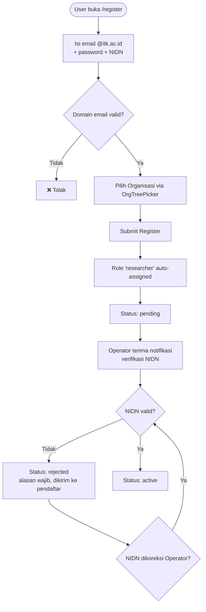
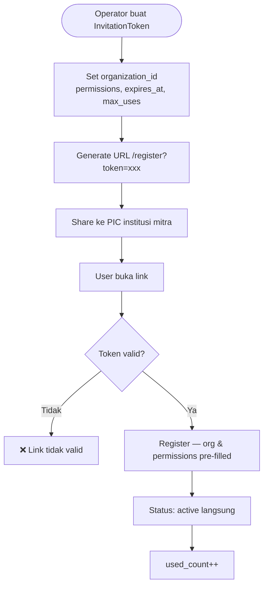
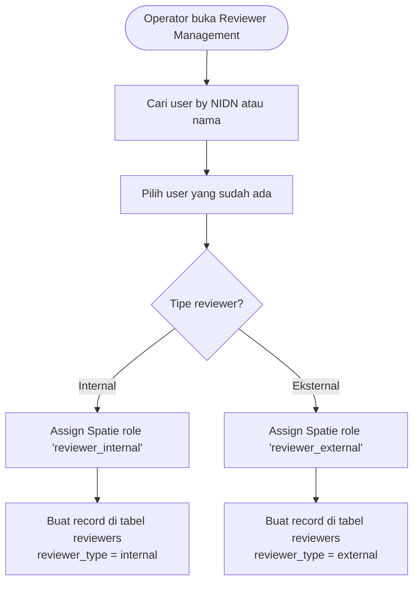
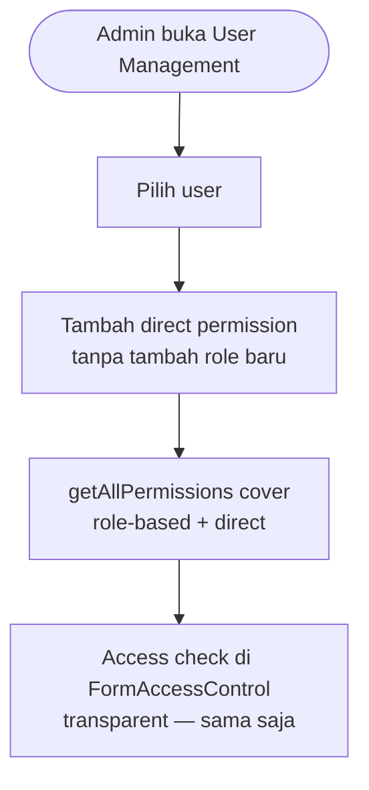
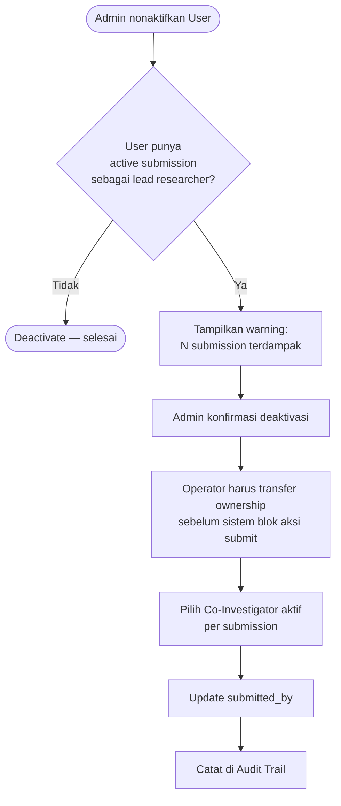
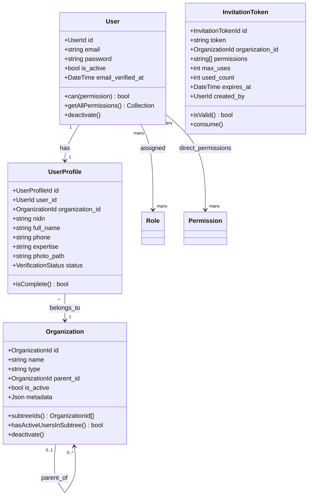

# BC: Identity & Access

**Klasifikasi:** 🟢 Generic Domain  
**Versi:** 2.5  
**Status:** Draft

---

## Responsibility

Mengelola autentikasi, profil user, hierarki organisasi, dan kontrol akses. Dua pilar:

- **Spatie Permission** → _apa yang boleh dilakukan_ (authorization)
- **Organization tree** → _dari mana user berasal_ (identity/scope)

`FormAccessControl` menggunakan **permission + org** — bukan role + org.

---

## Activity Diagram

### Jalur 1 — Self-Register (Dosen ITK)



### Jalur 2 — Invitation Link (External)



### Jalur 3 — Reviewer (Ditunjuk Operator)



### Custom Permission untuk User Spesifik



### Transfer Ownership (Lead Researcher Nonaktif)



---

## Aggregates



---

## Spatie Permission Design

**Permissions:**

```
submissions.create        submissions.view-own
submissions.view-all      budget.edit
members.manage            reviewers.assign
reviewers.evaluate        reviewers.view-scores-others
periods.manage            schemes.manage
outputs.manage            users.verify
users.manage              reporting.export
reporting.view-audit-log
```

**Roles:**

| Role                | Permissions                                                                            |
| ------------------- | -------------------------------------------------------------------------------------- |
| `researcher`        | submissions.create, view-own, budget.edit, members.manage, outputs.manage              |
| `reviewer_internal` | reviewers.evaluate, submissions.view-assigned, reviewers.view-scores-others            |
| `reviewer_external` | reviewers.evaluate, submissions.view-assigned                                          |
| `operator`          | submissions.view-all, reviewers.assign, periods.manage, users.verify, reporting.export |
| `admin`             | semua                                                                                  |

---

## Access Check — Permission + Org

```php
function canAccessForm(User $user, Form $form): bool
{
    $userPermissions = $user->getAllPermissions()->pluck('name');
    // Form terlihat oleh organisasi tempat ia dipasang DAN semua unit di bawahnya,
    // jadi yang dicari adalah leluhur organisasi user — bukan keturunannya.
    // Lihat ADR 0013.
    $userOrgAncestors = Organization::ancestorIds($user->profile->organization_id);

    return FormAccessControl::where('form_id', $form->id)
        ->whereIn('permission', $userPermissions)
        ->whereIn('organization_id', $userOrgAncestors)
        ->exists();
}
```

PostgreSQL recursive CTE untuk leluhur (bisa di-cache Redis TTL 30 menit):

```sql
WITH RECURSIVE org_ancestors AS (
    SELECT id, parent_id FROM organizations WHERE id = $1
    UNION ALL
    SELECT o.id, o.parent_id FROM organizations o
    INNER JOIN org_ancestors oa ON o.id = oa.parent_id
    WHERE o.is_active = true
)
SELECT id FROM org_ancestors;
```

Penelusuran **naik**, bukan turun. `Organization::subtreeIds()` yang menelusuri turun
tetap ada dan tetap benar untuk pelaporan agregat ("unit apa saja di bawah saya"),
tapi ia bukan jawaban untuk access control. Jejak lengkapnya di
[ADR 0013](../../../adr/0013-form-access-control-matches-ancestor-organizations.md).

---

## Business Rules

| Kode      | Rule                                                                                                                                                    |
| --------- | ------------------------------------------------------------------------------------------------------------------------------------------------------- |
| BR-IAM-01 | Email domain `@itk.ac.id` wajib untuk self-register internal. Pencocokannya **domain persis, case-insensitive** — subdomain (`@student.itk.ac.id`) dan domain yang sekadar berakhiran sama (`@itk.ac.id.example.com`) ditolak. Jalur undangan **tidak** dibatasi domain: memasang pengecekan ini di lapis yang salah membuat mitra eksternal tidak pernah bisa masuk |
| BR-IAM-02 | NIDN harus unik di seluruh sistem. Keunikan berlaku atas NIDN yang **terisi** — jalur undangan tidak meminta NIDN, dan sejumlah akun tanpa NIDN tidak saling bentrok |
| BR-IAM-03 | UserProfile wajib lengkap sebelum Researcher bisa membuat Submission                                                                                    |
| BR-IAM-04 | User status `pending` bisa login, **membuat dan menyunting DRAFT**, tapi tidak bisa submit. Verifikasi menggerbang *komitmen*, bukan *persiapan* — tidak ada yang mengikat sampai submit, sementara verifikasi NIDN makan waktu berhari-hari. Kelengkapan profil adalah gerbang terpisah untuk membuat submission (BR-IAM-03) |
| BR-IAM-05 | Deaktivasi User tidak delete data — `is_active = false`. Yang berubah adalah kemampuannya bertindak: akun nonaktif **tidak bisa login** dan **tidak menerima penugasan baru**, sementara penugasan yang sudah berjalan tidak ikut hilang (digantikan lewat [BR-REV-10](../core/02_review.md)) dan seluruh jejaknya tetap terbaca |
| BR-IAM-06 | InvitationToken invalid jika `used_count >= max_uses`, `expires_at` lewat, **dicabut Operator**, atau organisasinya sudah dihapus/nonaktif. Token yang belum terpakai **tidak** menghalangi penghapusan organisasi — ia dicabut, dan Operator diberi tahu berapa yang akan tercabut sebelum mengonfirmasi. Undangan yang terlanjur dibuka mendarat di layar token tidak berlaku |
| BR-IAM-07 | **Bagian dari [BR-REV-02](../core/02_review.md).** User dengan role `reviewer_internal` atau `reviewer_external` tidak bisa me-review submission yang ia menjadi ResearchMember-nya                        |
| BR-IAM-08 | Organization tidak bisa di-delete jika masih ada UserProfile di subtree-nya — **UserProfile apa pun**, aktif maupun tidak. Operasi sehari-harinya adalah deaktivasi (BR-IAM-14), yang ambangnya berbeda: user **aktif** |
| BR-IAM-09 | Direct permission ke user tidak menghapus permission dari role — keduanya additive                                                                      |
| BR-IAM-10 | Jika lead researcher dinonaktifkan dengan active submission, Operator wajib transfer ownership ke Co-Investigator aktif sebelum deaktivasi dikonfirmasi Dicerminkan [BR-SM-09](../core/01_submission.md). |
| BR-IAM-11 | Reviewer dibuat Operator dari user yang **sudah terdaftar** — tidak ada jalur registrasi mandiri untuk reviewer. `reviewer_type` (`internal`/`external`) menentukan role Spatie yang diberikan, dan role itulah yang dipakai [BR-REV-11](../core/02_review.md) untuk membatasi keterlihatan skor. Penunjukan **idempoten per orang**: menunjuk ulang seseorang yang sudah reviewer memperbarui `reviewer_type` dan masa tugas pada record yang ada, bukan membuat record kedua — dua record untuk satu orang membuat penghitungan beban [BR-REV-04](../core/02_review.md) dan keterlihatan skor membaca dari himpunan yang ambigu |
| BR-IAM-12 | Jalur registrasi menentukan **bekal awal** akun. Self-register memberi role `researcher`, organisasi yang dipilih pendaftar lewat OrgTreePicker, dan status `pending`. Jalur undangan memberi organisasi **dan permission** yang tertera di token, dan status `active` **langsung** — tidak ada NIDN untuk diverifikasi, dan Operator sudah menyaring saat menerbitkan token. Pendaftar lewat undangan karena itu tidak pernah masuk antrian verifikasi |
| BR-IAM-13 | Verifikasi NIDN bisa berakhir **ditolak**. Penolakan wajib menyertakan alasan tertulis yang dikirimkan ke pendaftar, dan memindahkan akun ke status `rejected` yang tidak bisa submit. Penolakan **tidak terminal**: Operator tetap bisa memverifikasi akun itu setelah NIDN-nya dikoreksi. Email dan NIDN yang terlanjur terpakai membuat pendaftaran ulang mustahil (BR-IAM-02), jadi penolakan permanen berarti mematikan akun karena salah ketik |
| BR-IAM-14 | Organisasi **dinonaktifkan** (`is_active = false`), bukan dihapus, begitu ia pernah dipakai. Deaktivasi ditolak selama masih ada user **aktif** di subtree-nya — pindahkan orangnya lebih dulu. Organisasi nonaktif memutus rantai leluhur di access control ([BR-FE-02](01_form_engine.md), lihat `WHERE o.is_active = true` pada CTE di atas) dan membatalkan token undangannya (BR-IAM-06). Ia tidak menghapus apa pun: pengajuan dan profil lama tetap terbaca |
| BR-IAM-15 | Keputusan yang mengubah keadaan akun seseorang **memberi tahu pihak yang harus bertindak atasnya**: pendaftaran baru memberi tahu Operator lewat antrian verifikasi, sedangkan verifikasi, penolakan verifikasi, deaktivasi, dan penunjukan reviewer memberi tahu user yang bersangkutan. Perubahan yang user lakukan sendiri tidak memberitahunya kembali. Channel-nya konfigurasi ([BR-NOT-06](03_notification.md)), bukan bagian dari aturan ini |
| BR-IAM-16 | Penerbitan dan pencabutan `InvitationToken` adalah **wewenang Operator**. Pencabutan menyetel `revoked_at` — bukan menghapus token — dan menghentikan seluruh kuota yang tersisa, sementara akun yang terlanjur lahir **tidak terpengaruh**. Tanpa jalur pencabutan, tautan undangan yang bocor tidak punya cara dimatikan selain menunggu kedaluwarsa |
| BR-IAM-17 | Unit organisasi dibuat, diganti nama, dan dipindah induknya oleh Operator. Pemindahan **ditolak** kalau menjadikan sebuah unit keturunan dirinya sendiri: access control [BR-FE-02](01_form_engine.md) menelusuri rantai leluhur lewat CTE rekursif, dan pohon bersiklus membuat penelusuran itu tidak berhenti — kegagalannya muncul sebagai timeout di layar peneliti yang tidak bersalah |
| BR-IAM-18 | `UserProfile` dipindah antar unit organisasi oleh Operator. Ini **prasyarat yang disebut [BR-IAM-14](#business-rules)**: deaktivasi unit menuntut "pindahkan orangnya lebih dulu", dan aturan yang memberi resep wajib menyediakan obatnya. Tanpa jalur ini satu-satunya jalan keluar Operator adalah menonaktifkan orangnya — mengubah keadaan manusia demi merapikan struktur |
| BR-IAM-19 | `User` **tidak pernah dihapus**, hanya dinonaktifkan ([BR-IAM-05](#business-rules)). Jalur penghapusan menembus penjagaan yang dipasang jalur deaktivasi: [BR-IAM-10](#business-rules) menolak menonaktifkan lead researcher yang masih memegang pengajuan aktif sampai kepemilikannya dipindah, dan aturan itu kehilangan artinya kalau tersedia jalur lain yang lebih merusak tanpa penjagaan apa pun |
| BR-IAM-21 | Sesi login adalah keadaan akun yang dapat dibaca dan diakhiri. Pemegang `users.verify` atau `users.manage` melihat kapan seorang user terakhir aktif dan apakah ia sedang aktif. Yang dimaksud "sedang aktif" adalah ada sesi dengan aktivitas dalam 5 menit terakhir; datanya diturunkan dari sesi, bukan dari pelacakan halaman. Pemegang `users.manage` dapat mengakhiri seluruh sesi seorang user tanpa menonaktifkannya (perangkat hilang, kata sandi bocor), dan tindakan itu diaudit. Deaktivasi ([BR-IAM-05](#business-rules)) selalu mengakhiri seluruh sesi |

---

## Domain Events

| Event               | Trigger                  | Consumer                                           |
| ------------------- | ------------------------ | -------------------------------------------------- |
| `UserRegistered`    | User berhasil register   | Notification                                       |
| `UserVerified`      | Operator verifikasi NIDN | Notification                                       |
| `UserVerificationRejected` | Operator menolak NIDN | Notification (alasan ikut terkirim — BR-IAM-13)  |
| `UserDeactivated`   | Admin nonaktifkan user   | Notification, Submission (trigger ownership check) |
| `ReviewerAppointed` | Operator assign reviewer | Notification                                       |
| `OrganizationDeactivated` | Admin nonaktifkan unit | Form Engine (invalidasi cache leluhur), IAM (cabut token) |

Keempat event pertama adalah wujud [BR-IAM-15](#business-rules): setiap perubahan keadaan
akun yang **diputuskan orang lain** memberi tahu pihak yang harus bertindak atasnya.
Perubahan yang user lakukan sendiri — melengkapi profil, mengganti password — tidak
menerbitkan event, karena tidak ada yang perlu diberi tahu.

---

## Status Akun dan Status Organisasi

Dua sumbu keadaan yang sering tertukar. Keduanya boolean-ish tapi menjawab pertanyaan
berbeda, dan implementasi yang menggabungkannya akan salah di kasus yang paling sering
terjadi.

| Sumbu | Nilai | Artinya |
| ----- | ----- | ------- |
| `UserProfile.status` (`VerificationStatus`) | `pending` · `active` · `rejected` | Sudahkah **NIDN-nya** diverifikasi Operator. Menggerbang **submit** (BR-IAM-04, BR-IAM-13) |
| `User.is_active` | `true` · `false` | Masihkah orangnya **berdinas**. Menggerbang **login** (BR-IAM-05) |
| `UserProfile::isComplete()` | turunan | Sudahkah data tambahan (telepon, bidang keahlian, foto) diisi. Menggerbang **pembuatan submission** (BR-IAM-03) |
| `Organization.is_active` | `true` · `false` | Masihkah unitnya dipakai. Memutus rantai leluhur access control dan membatalkan tokennya (BR-IAM-14) |

Tiga gerbang, tiga pertanyaan, tiga jawaban berbeda — dan satu user bisa lolos yang satu
sambil tertahan yang lain. Akun `pending` dengan profil lengkap boleh membuat DRAFT tapi
tidak boleh submit; akun `active` dengan profil kosong tidak boleh membuat DRAFT sama
sekali. Menyatukan ketiganya jadi satu kolom "user siap?" akan membuat salah satu dari
dua kasus itu berperilaku salah tanpa ada yang gagal secara mencolok.

`rejected` sengaja **tidak terminal**. Registrasi ulang mustahil karena email dan NIDN
sudah terpakai (BR-IAM-02), jadi penolakan yang tidak bisa dibatalkan berarti akun mati
gara-gara satu digit NIDN salah ketik.

---

## Integration Map

| Context              | Arah                | Keterangan                                   |
| -------------------- | ------------------- | -------------------------------------------- |
| Submission           | IAM → Downstream    | UserProfileId untuk lead researcher & member |
| Review               | IAM → Downstream    | UserProfileId untuk Reviewer                 |
| System Configuration | Upstream → IAM      | Lookup untuk OrgType definitions             |
| Notification         | IAM → Cross-cutting | Publish events                               |
| Reporting            | IAM → Read          | User data untuk audit trail dan statistik    |
