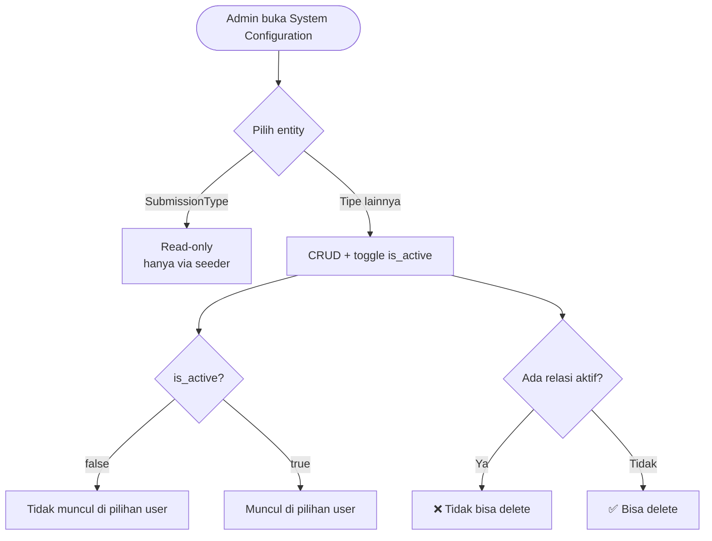
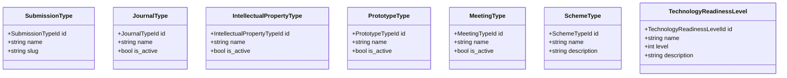

# BC: System Configuration

**Klasifikasi:** 🟢 Generic Domain  
**Versi:** 2.0  
**Status:** Draft

---

## Responsibility

Master data yang digunakan context lain sebagai lookup. **Tidak lagi** mencakup Faculty dan StudyProgram — keduanya sudah digantikan oleh `Organization` tree di BC Identity & Access.

---

## Activity Diagram

---

## Entities

## Data per Consumer

| Entity                     | Dikonsumsi oleh                   |
| -------------------------- | --------------------------------- |
| `SubmissionType`           | Scheme, Submission, Review, Monev |
| `JournalType`              | Research Output                   |
| `IntellectualPropertyType` | Research Output                   |
| `PrototypeType`            | Research Output                   |
| `MeetingType`              | Research Output                   |
| `SchemeType`               | Scheme                            |
| `TechnologyReadinessLevel` | Scheme                            |

## Mengganti Nama vs Mengganti Makna

Dua hal yang sering tertukar di layar yang sama:

| Yang terjadi                          | Tindakan yang benar                     | Akibat pada data lama             |
| ------------------------------------- | --------------------------------------- | --------------------------------- |
| Ejaan/istilahnya diperbaiki           | Ganti nama                              | Ikut memakai nama baru — memang satu hal yang sama |
| Kategorinya berubah makna             | Buat entity baru, nonaktifkan yang lama | Tetap menunjuk entity lama dengan nama lamanya |

Mengganti nama untuk kasus kedua adalah cara paling cepat membuat laporan tahun
lalu berbohong. Yang menahannya bukan aturan teknis melainkan tersedianya jalan
kedua — karena itu `is_active` ada, dan karena itu BR-SC-01 tidak pernah
mengizinkan entity yang masih dipakai dihapus.

---

## Business Rules

| Kode     | Rule                                                    |
| -------- | ------------------------------------------------------- |
| BR-SC-01 | Entity tidak bisa di-delete jika masih ada relasi aktif |
| BR-SC-02 | `SubmissionType` immutable — hanya via seeder           |
| BR-SC-03 | Mengganti nama entity acuan **tidak menyentuh baris historis**: tautannya tetap menunjuk entity yang sama, tidak ada baris yang ditulis ulang, dihapus, atau dibuat ulang. Yang **tidak** dijaminkan adalah nama lamanya tetap tampil di laporan lama — tidak ada snapshot nama di mana pun, dan menambahkannya berarti mendenormalisasi setiap tabel yang menunjuk entity acuan demi kasus yang punya jalan keluar lebih baik. Kalau kategorinya memang berubah makna, jalannya bukan mengganti nama melainkan **membuat entity baru lalu menonaktifkan yang lama** — BR-SC-01 menjaga yang lama tidak terhapus dan `is_active` menjaganya tidak lagi ditawarkan |
| BR-SC-04 | `OutputTypeDefinition` termasuk data acuan yang dikelola LPPM — taksonomi luaran adalah keputusan bisnis, bukan kosakata mesin Form Engine. Ia mengikuti aturan yang sama dengan acuan lain: penghapusan ditolak selama masih dipakai ([BR-SC-01](#business-rules)), penggantian nama tidak menyentuh baris historis ([BR-SC-03](#business-rules)), dan yang berhenti berlaku **dinonaktifkan**. Tanpa jalur pengelolaan, `is_active` yang sudah dibaca [BR-SM-14](../core/01_submission.md) dan [BR-RO-05](../supporting/03_research_output.md) menyiapkan diri untuk keadaan yang tidak pernah bisa terjadi |
