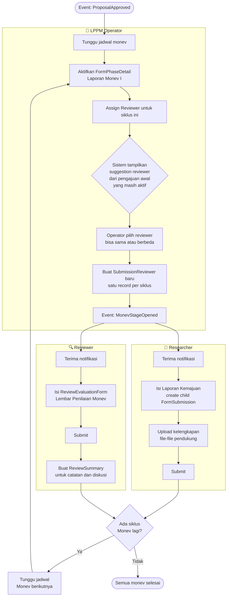
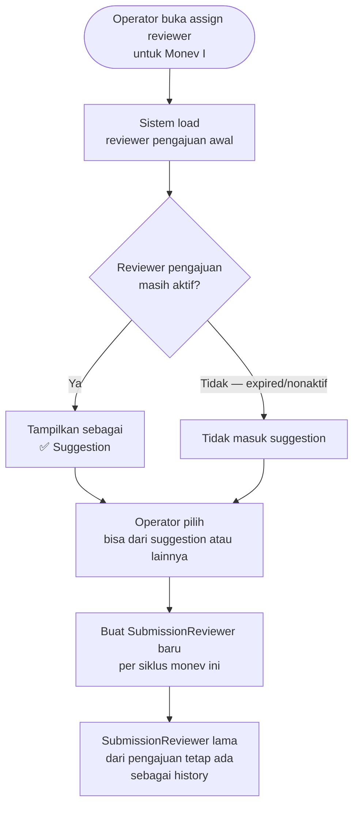

# BC: Monev (Monitoring & Evaluation)

**Klasifikasi:** 🟡 Supporting Domain  
**Versi:** 2.5  
**Status:** Draft

> **Perubahan v2.3 → v2.4.** BR-MON-03 diperbaiki dari "satu **researcher**"
> menjadi "satu **parent FormSubmission**" per FormPhaseDetail — bacaan lama
> salah memblokir researcher yang punya dua proposal APPROVED sekaligus
> (BR-SM-01 mengizinkan dua skema berbeda dalam satu period); index yang
> sudah dikirim M0 (`one_child_submission_per_phase_detail`, per
> `parent_submission_id`) sudah benar sejak awal, teks aturannya yang
> menyusul.

---

## Responsibility

Mengelola siklus monitoring dan evaluasi untuk Submission yang sudah APPROVED. Monev adalah bagian dari satu FormPhase yang sama dengan pengajuan — bukan phase terpisah. Reviewer untuk setiap siklus monev di-assign manual oleh Operator dengan suggestion dari reviewer pengajuan awal.

---

## Konsep Kunci: Satu FormPhase, Satu Lifecycle

```
FormPhase: "Penelitian DIPA 2025"
│
├── Detail 1  order=1  Pengajuan          researcher    needs_review=true   deadline="Batas Submit"
│             ← saat status NEEDS_REVISION, detail ini dibuka lagi sampai "Batas Revisi"
├── Detail 2  order=2  Evaluasi Pengajuan reviewer      ReviewEvaluationForm deadline="Batas Evaluasi"
│             ← gate: tidak bisa lanjut sebelum semua ReviewSummary resolved
│
├── Detail 3  order=3  Laporan Monev I    researcher    needs_review=true   deadline="Batas Monev I"
│             ← child FormSubmission (parent = submission pengajuan utama)
├── Detail 4  order=4  Evaluasi Monev I   reviewer      ReviewEvaluationForm deadline="Batas Monev I"
│
├── Detail 5  order=5  Laporan Monev II   researcher    needs_review=false  deadline="Batas Monev II"
├── Detail 6  order=6  Evaluasi Monev II  reviewer      ReviewEvaluationForm deadline="Batas Monev II"
│
└── Detail 7  order=7  Upload Luaran      researcher    needs_review=false  deadline="Batas Akhir"
```

Semua FormSubmission dalam lifecycle ini terhubung via `parent_submission_id` ke submission pengajuan utama. Tidak ada ambiguitas "monev ini dari pengajuan yang mana."

Perhatikan Detail 1 dan Detail 2 memakai **tanggal yang berbeda**. Keduanya punya aktor
berbeda — researcher dan reviewer — dan tahapannya berurutan, jadi memakai ulang
`"Batas Submit"` akan membuat jendela kerja reviewer nol (BR-FE-17). Dengan alasan yang
sama, revisi membuka kembali Detail 1 sampai `"Batas Revisi"`, bukan sampai batas submit
yang sudah lewat.

---

## Activity Diagram

### Alur Siklus Monev



---

## Tidak Ada Tabel Baru

| Data                         | Tabel yang dipakai                                                        |
| ---------------------------- | ------------------------------------------------------------------------- |
| Laporan kemajuan researcher  | `form_submissions` (child) + `form_field_responses`                       |
| File laporan dan kelengkapan | `form_field_responses` (field_type = file)                                |
| Penilaian reviewer           | `review_form_responses` + `review_form_field_responses`                   |
| Catatan dan diskusi          | `review_summaries` + `review_comments`                                    |
| Luaran penelitian            | `research_outputs` (extension table terpisah, bukan child FormSubmission) |

---

## Reviewer Assignment per Siklus



---

## Business Rules

| Kode      | Rule                                                                                                                |
| --------- | ------------------------------------------------------------------------------------------------------------------- |
| BR-MON-01 | Monev hanya bisa diakses setelah FormSubmission pengajuan utama berstatus APPROVED                                  |
| BR-MON-02 | Researcher tidak bisa mengisi Detail berikutnya sebelum Detail sebelumnya `canProceed()`. **`canProceed()` computed, bukan kolom** — sejajar `isArchived()` (BR-SM-13): ia bernilai true kalau detail itu sudah disubmit DAN, bila `needs_review = true`, evaluasinya selesai tanpa ReviewSummary `open`. Tidak ada yang "menyetel" gerbang ini; ia turunan dari keadaan |
| BR-MON-03 | Satu parent FormSubmission hanya bisa punya satu child FormSubmission per FormPhaseDetail (per parent, bukan per researcher — satu researcher boleh punya lebih dari satu parent APPROVED sekaligus, lihat BR-SM-01) |
| BR-MON-04 | Reviewer untuk setiap siklus monev di-assign manual oleh Operator                                                   |
| BR-MON-05 | **Penerapan [BR-FE-07](../generic/01_form_engine.md) + [BR-FE-08](../generic/01_form_engine.md) pada fase monev.** Setiap FormPhaseDetail monev punya hard deadline — lewat deadline, akses ditutup kecuali ada FormSubmissionOverride. Tidak ada mekanisme deadline kedua |
| BR-MON-06 | Satu SubmissionReviewer baru dibuat per siklus — tidak reuse record dari siklus sebelumnya                          |
| BR-MON-07 | Reviewer pengajuan awal yang sudah tidak aktif (expired `end_date`) tidak muncul di suggestion monev                |
| BR-MON-08 | Submission yang WITHDRAWN saat monev sedang berjalan — siklus monev aktif di-freeze, tidak bisa submit laporan baru |
| BR-MON-09 | Hasil evaluasi monev terlihat Researcher **begitu reviewer submit**, tidak menunggu siklus berakhir. Ini pengecualian eksplisit atas [BR-REV-12](../core/02_review.md), yang menahan skor sampai APPROVED/REJECTED. Alasannya monev bersifat formatif — koreksi arah kegiatan mustahil kalau catatannya baru terbaca setelah kegiatannya usai |
| BR-MON-10 | Dua peristiwa siklus monev memberi tahu pihak yang harus bertindak. `MonevStageOpened` memberi tahu **peneliti** (laporannya ditunggu) dan **reviewer yang ditugaskan pada siklus itu** (penilaiannya ditunggu). `MonevEvaluationSubmitted` memberi tahu peneliti. Siklus yang belum dibuka tidak memberi tahu siapa pun — jadwal monev berjarak bulanan, dan tanpa pemberitahuan tenggatnya terlanjur berjalan sebelum ada yang membukanya |

---

## Domain Events

| Event                      | Trigger                                 | Consumer     |
| -------------------------- | --------------------------------------- | ------------ |
| `MonevStageOpened`         | Operator aktifkan FormPhaseDetail monev | Notification |
| `MonevEvaluationSubmitted` | Reviewer submit penilaian monev         | Notification |

---

## Integration Map

| Context     | Arah             | Keterangan                                        |
| ----------- | ---------------- | ------------------------------------------------- |
| Form Engine | Upstream → Monev | Semua infrastruktur dari FE — tidak ada yang baru |
| Submission  | Upstream → Monev | Parent FormSubmission harus APPROVED              |
| Review      | Lateral          | Pola ReviewEvaluationForm + ReviewSummary identik |
| Reporting   | Monev → Read     | Data monev untuk laporan progress dan export      |
